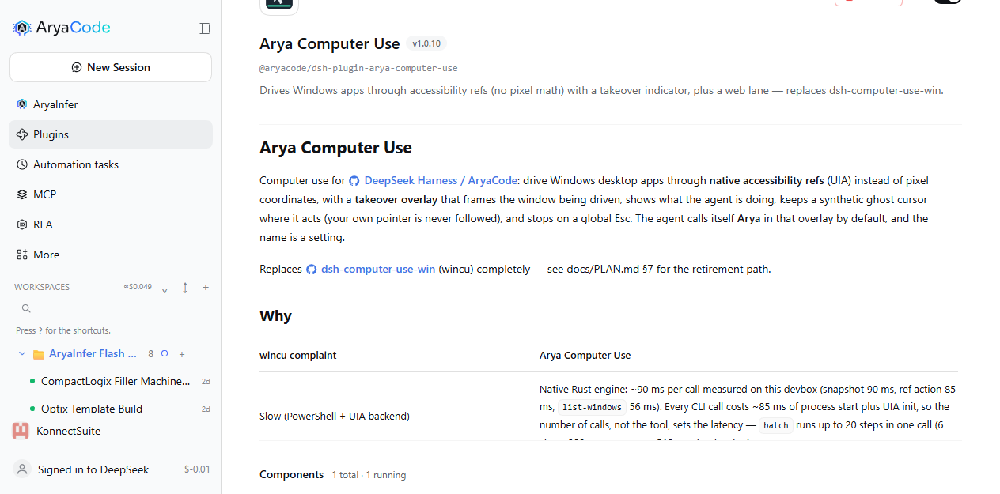

# Arya Computer Use

[](https://www.npmjs.com/package/@aryacode/dsh-plugin-arya-computer-use)


A computer-use plugin for DSH/AryaCode built on Vercel's new desktop and browser-use MCP
servers — [`agent-desktop`](https://github.com/vercel-labs/agent-desktop) (Windows accessibility
refs) and [`agent-browser`](https://github.com/vercel-labs/agent-browser) (web lane) — with a
takeover UI: the driven window is framed, every action is marked with a ghost cursor, and a
global **Esc** stops it.



It drives Windows desktop apps through **native accessibility refs** (UIA) instead of pixel
coordinates, and drives web pages through a CDP browser lane. The agent calls itself **Arya**
in the overlay by default, and the name is a setting.

- **Refs, not pixels.** `snapshot` returns a semantic tree of addressable controls; coordinates
  are never the targeting mechanism, and identical twins are refused, not mis-clicked.
- **Nothing moves your mouse unless you say so.** `click` picks the delivery rung that works for
  that control — the control's own UIA pattern, its advertised action, then a background posted
  click — and reports which one in `data.mechanism`. Real OS clicks, `type` and `focus` need an
  explicit opt-in.
- **Takeover UI.** The driven window gets a rim and a banner, a synthetic ghost cursor marks each
  action, a step panel shows progress, and a global Esc stops the drive — the stop also gates the
  driver, so a pressed Esc is honoured, not raced.
- **Two lanes.** `arya_desktop` (28 tools over UIA) and `arya_browser` (the agent-browser MCP
  profile you pick), mounted in-process — no absolute paths, no `npx` child.
- **Measured, not promised.** ~90 ms per engine call on the devbox (snapshot 90 ms, ref action
  85 ms, `list-windows` 56 ms); `batch` runs up to 20 steps in one call (6 steps: 332 ms engine
  vs ~510 ms step by step). Every CLI call costs ~85 ms of process start, so the number of calls,
  not the tool, sets the latency.

Releases: [GitHub Releases](https://github.com/KonnectSuite/dsh-arya-computer-use/releases) ·
[CHANGELOG.md](CHANGELOG.md) · npm package `@aryacode/dsh-plugin-arya-computer-use`.

## Requirements

- **Windows**, and a **DSH host running elevated (Run as administrator).** The engine's
  interaction lease lives at `C:\ProgramData\agent-desktop\<user-SID>\interaction.lock` with a
  protected DACL `{SYSTEM, Administrators, token user}`; a non-elevated medium-IL token fails
  validation (`lease_directory_untrusted`), and the adapter surfaces that as an explicit "run
  AryaCode as administrator" hint.
- Accessibility permission (`desktop_status` reports `accessibility: granted`).
- AryaCode / DSH host matching `dsh.engines.dsh` (`>=0.2.1-rc.3 <0.3.0-0`).
- Engine state root is the engine default `~/.agent-desktop` — do **not** point
  `AGENT_DESKTOP_HOME` at `%LOCALAPPDATA%` (inherited AppContainer ACEs fail the engine's
  private-DACL check).

## Install

### From the plugin market (recommended)

1. In AryaCode: **Plugins → Arya Plugin Market → add a source** and paste
   `https://cdn.jsdelivr.net/gh/KonnectSuite/dsh-arya-computer-use@latest/index.json`
2. Install **Arya Computer Use** from the list, then restart AryaCode.

The published package is `@aryacode/dsh-plugin-arya-computer-use` (npm, public). Everything it
needs ships in the tarball: the desktop adapter, the browser launcher, the takeover overlay
sources and the skill. The two MCP lanes are mounted **in-process** by `index.js`
(`ctx.plugin(<bridge>, …)`), so there are no absolute paths in the bundle patch and no `npx`
child process — an install works the same on any machine.

The plugin manager blocks dependency build scripts by default. The engines (`agent-desktop`,
`agent-browser`) fetch their native binary in a postinstall script; approve those two builds when
installing, or let 1.0.1+ repair them itself at start-up — the status route reports the outcome
under `mcp.engines`.

### From npm

`@aryacode/dsh-plugin-arya-computer-use` — install it into your AryaCode profile with the plugin
manager, or pin it in the profile's `package.json`.

### From a checkout (development)

`plugin_manager` → `install_bundle` pointing at this directory. The bundle patch is a single row
(`arya-computer-use`); the MCP lanes still mount in-process, so a checkout install and a registry
install behave identically.

## Where it appears

- **Plugins panel** — an *Arya Computer Use* row with an enable switch and a detail page.
- **Settings → Plugins → Computer Use** — the plugin's settings page (table below).
- **The desktop, while driving** — a rim around the driven window, a banner
  ("Arya is controlling your computer"), a ghost cursor at each action, and a step panel
  (`Arya · Step 3 · acting`).
- **The conversation** — each desktop/web tool call renders as a step row with the action, the
  target and the delivery mechanism.
- **Two MCP lanes** — tools named `mcp__arya_desktop__*` and `mcp__arya_browser__*` in every
  session.

## First run

1. Start AryaCode **as administrator** (the lease requirement above).
2. Open **Settings → Plugins → Computer Use** and confirm the status shows the engines mounted
   and accessibility granted.
3. Ask the agent: *"open Notepad and type hello"*. Watch the window get framed, the ghost cursor
   move, and the step panel count.
4. Press **Esc** at any moment — the drive stops and desktop input tools refuse for that turn.

## Settings (Settings → Plugins → Computer Use)

| Setting | Default | Meaning |
| --- | --- | --- |
| Frame the app window | on | Rim only the driven window plus a banner; monitor edges are just the fallback before a target is known |
| Show a ghost cursor | on | Draw a synthetic cursor where the agent acts; your pointer is never followed |
| Agent name | `Arya` | Drives the ghost-cursor tag and the progress-panel header (`Arya · Step 3 · acting`), 1–16 characters |
| Banner text | `Arya is controlling your computer` | One line, 1–120 characters |
| Real mouse and keyboard | off | Opts the conversation into physical input for 5 minutes (`session_end` releases it): clicks that need it become real OS clicks, `type`/`focus`/`focus_window` stop refusing. Off, `click` still works — it uses the control's own UIA pattern, its own advertised action, or a background posted click, and never moves your pointer. |
| One conversation drives at a time | on | Refuses desktop tools in other conversations while a drive is live |
| Progress panel detail | `summary` | What the on-screen step panel prints: `summary` = short action lines, `source` = the assistant's raw text stream (the old default — it paints model text on your desktop) |
| Stop shortcut | Esc | Global kill switch; synthetic keystrokes are ignored, so it needs a real keypress. It also gates the driver: desktop input tools return `COMPUTER_USE_STOPPED_BY_USER` for that turn (reads keep working) |
| Tool preset | `lite` | `lite` lists all 28 desktop tools; `lazy` starts with tools/snapshot/click and reveals the rest on demand |
| Tool surface (web) | `core` | agent-browser tool profile: core 29, network 9, state 27, debug 40, tabs 13, react 8, mobile 15, webmcp 4, all 156 |
| Chrome profile / Session | – / `arya` | Reuse a Chrome login state and name the browser session |
| Connect to my browser | – | `--cdp` port or URL to attach to a Chrome you already have open |
| Saved sign-in state | – | Absolute path to a cookies+localStorage JSON to reuse |
| Browser executable path | – | Absolute path to msedge.exe / chrome.exe / brave.exe when the web lane starts its own browser; empty finds system Chrome |
| Show the browser window | off | `--headed` for the web lane |

## Tool presets

- `lite` (default) — all 28 desktop tools listed up front:
  `snapshot, find, get, is, click, select, check, uncheck, clear, scroll_to, focus, focus_window,
  double_click, right_click, expand, collapse, toggle, set_value, type, press, scroll,
  list_windows, launch, wait, screenshot, ocr, batch, tools`.
- `lazy` — starts with `tools`, `snapshot`, `click`; everything else appears after
  `tools {operation:"load", names:[...]}`. The adapter advertises `tools.listChanged` and emits
  `notifications/tools/list_changed`, which DSH's MCP client re-syncs
  (`listChanged.onChanged → refreshTools`), so the new tools become callable immediately.

## Web lane

The second MCP row (`arya_browser`, server `agent-browser`) runs through `mcp/browser-launcher.mjs`,
a transparent stdio pipe that reads the control file and spawns the real server with the settings
applied:

```
node mcp/browser-launcher.mjs          # → agent-browser mcp --tools core [--profile X] [--session Y] [--state Z] [--cdp ...] [--headed]
```

So sign-in reuse and attaching to your own Chrome are settings, not hand-edited rows. Web-lane
changes land on the next MCP restart; the settings page says so.

## How clicks work

`click` picks the delivery rung that works for that control and reports it in `data.mechanism`:

| mechanism | what happened | your pointer / foreground |
| --- | --- | --- |
| `semantic` | the control ran its own UIA pattern (Invoke or Legacy default action) | untouched |
| `select` `toggle` `expand` `collapse` | click refused; the control's own advertised action did it | untouched |
| `post_message` | a mouse message posted straight to the control's window | untouched |
| `physical_synthetic` | a real OS click at the element centre — only when physical input is opted in | moves both |

A refusal caused by the exclusive desktop interaction lease (`TIMEOUT` /
`details.kind: "lock_timeout"`) is not a verdict: the adapter retries the engine call twice with
backoff before the ladder answers it.

`set_value` fills a field through the accessibility value pattern (the headless text path).
`select`/`check`/`uncheck`/`clear`/`scroll_to`/`toggle`/`expand`/`collapse` are semantic engine
commands and stay headless. `type`, `focus`, `focus_window` and a `physical: true` click
synthesise real input: each needs `physical: true` on the call (or the conversation-wide
`tools {operation:"headed",on:true}` opt-in, 5 minutes) and otherwise refuses with
`POLICY_DENIED` / `details.kind: "physical_input_requires_consent"`. `double_click` and
`right_click` are posted in the background by default and physical only with consent. `tools`
manages the opt-in, overlay and session state.

## Status

All four planned phases have shipped.

| Phase | Deliverable | Status |
| --- | --- | --- |
| 0 | Evaluation spike: raw `agent-desktop mcp` row, drive Notepad/Explorer/Chrome — speed ✓, readable trees ✓, refs-not-pixels ✓ | ✅ accepted, spike removed |
| 1 | Adapter MCP server: tool surface, per-conversation session lifecycle, headed toggle + foreground promotion, screenshot→file path, WinRT OCR, skill | ✅ built, installed, driven in-host |
| 2 | Takeover UI: window rim + banner + Esc kill, configurable ghost cursor, settings page, chat step rows, driver lock, English UI | ✅ built + verified live |
| 2.1 | Clicks that never touch your mouse: semantic rung, the control's own action, then a background posted click; `select`/`check`/`uncheck`/`clear`/`scroll_to`/`focus_window` added; physical input behind an explicit opt-in; launch argv fixed | ✅ verified on a 21-step live matrix 2026-11-14 |
| 3 | Web lane (`arya_browser` row), sign-in profiles, attach-to-your-Chrome | ✅ shipped 1.0.0 |
| 4 | Lazy preset, notifications/clipboard/trace, npm publish | ✅ shipped 1.0.0 |

Full plan: [docs/PLAN.md](docs/PLAN.md). Release history: [CHANGELOG.md](CHANGELOG.md).

## Layout

```
package.json          Cordis bundle manifest (dsh.bundle.patch) + pinned engine deps
cordis.patch.yml      rows: arya-computer-use (Host), mcp-arya-desktop, mcp-arya-browser
index.js              Host plugin entry (settings, driver lock, takeover mgmt, status route)
client.js             Settings page + chat step rows (client plugin)
index.json            The market listing this repo serves (jsDelivr); regenerated at release
CHANGELOG.md          One entry per published version, newest first
mcp/adapter-server.mjs  adapter MCP server (28-tool surface)
mcp/browser-launcher.mjs  web-lane stdio pipe applying the settings to agent-browser mcp
mcp/quiet-input.mjs   driver for the background posted click (no cursor, no foreground)
scripts/quiet-input.ps1  posted WM_* click helper; elevated, caches its compiled DLL
scripts/windows-takeover.cs  window rim + banner + progress + ghost cursor + global Esc
scripts/ocr.ps1       WinRT OCR helper
scripts/sync-market-index.mjs  rebuild index.json from npm's publish times
skills/arya-desktop/  observe-act loop guide
locale/ icon.svg      Plugin Manager display metadata
docs/PLAN.md          complete v1 plan
NOTICE.md             engine attribution (Apache-2.0)
```

## Engines (not vendored — pinned npm dependencies)

- [`agent-desktop`](https://github.com/vercel-labs/agent-desktop) `1.2.0` (Apache-2.0) —
  accessibility-tree computer use CLI, native Windows binaries on npm. Reference mirror:
  [KonnectSuite/dsh-arya-agent-desktop](https://github.com/KonnectSuite/dsh-arya-agent-desktop).
- [`agent-browser`](https://github.com/vercel-labs/agent-browser) `0.41.2` (Apache-2.0) — web lane
  via CDP (`agent-browser mcp`).

Attribution and the licence boundary are in [NOTICE.md](NOTICE.md).

## Remove

Uninstall from the Plugins panel (or `plugin_manager`). To clear every trace:

- engine state: `~/.agent-desktop`
- control files: `%LOCALAPPDATA%\dsh-plugin-arya-desktop\control`
- the interaction lease: `C:\ProgramData\agent-desktop\<user-SID>`
- the market source the plugin registered: remove it in **Plugins → Arya Plugin Market → sources**

## Troubleshooting

| Symptom | What it means, what to do |
| --- | --- |
| `lease_directory_untrusted` | The host is not elevated. Restart AryaCode as administrator. |
| A tool returns `TIMEOUT` / `lock_timeout` | Another conversation holds the drive (the lease is exclusive, and `launch` holds it for its whole run). The adapter retries twice with backoff; press Esc to release the drive, or turn on *One conversation drives at a time*. |
| A canvas/game window shows no tree | It exposes no accessibility tree. Use `ocr` to read it and a `physical: true` click (your consent) to act on it. |
| `physical_input_requires_consent` | By design: `type`/`focus`/`focus_window`/`physical: true` need the opt-in. Turn on *Real mouse and keyboard* (5 minutes) or pass `physical: true` on the call. |
| Web-lane settings do not take effect | The web lane restarts with the MCP. Start a new session; the settings page says so. |
| `desktop_status` shows accessibility not granted | Grant it in Windows settings, then restart the host. |

## Plugin market

Installing from Plugins → Arya Plugin Market needs no manual source: on first run the plugin
registers its listing — a jsDelivr URL of this repository's `index.json` — with the market
(existing sources are kept), and every npm release shows up there as an update. Releases go
through npm staged publishing, so a publish is visible in the market once the version is approved
on npmjs.com.

## Licence

MIT (KonnectSuite original code). Engines stay Apache-2.0 — see [NOTICE.md](NOTICE.md).
