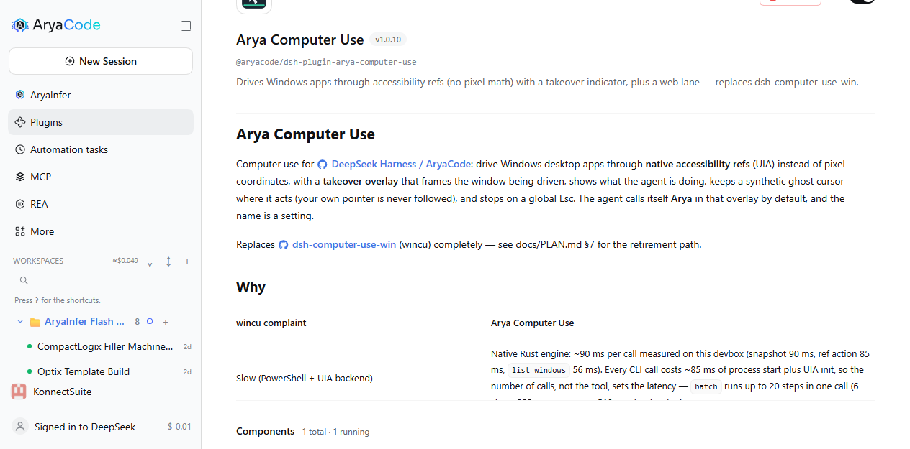

# Arya 电脑操控（Arya Computer Use）

[](https://www.npmjs.com/package/@aryacode/dsh-plugin-arya-computer-use)


Arya Computer Use 是为 DSH/AryaCode 设计的电脑操控插件，基于 Vercel 全新的桌面与浏览器操控
MCP——[`agent-desktop`](https://github.com/vercel-labs/agent-desktop)（Windows 辅助功能接口）与
[`agent-browser`](https://github.com/vercel-labs/agent-browser)（网页通道）——并带接管界面：
框住正在操作的窗口，用虚拟光标标出每步动作，按 **Esc** 立即停止。



它通过**原生辅助功能控件引用**（UIA）操控 Windows 桌面应用，而不是像素坐标；网页操作走 CDP
浏览器通道。接管界面里的智能体默认自称 **Arya**，这个名字是一个设置项。

- **控件引用，不是像素。** `snapshot` 返回可寻址控件的语义树；坐标永远不是定位手段，外观相同的
  控件会被拒绝而不是误点。
- **不动你的鼠标，除非你同意。** `click` 自动选择对该控件有效的投递层级——控件自身的 UIA 模式、
  控件声明的动作、后台投递的鼠标消息——并在 `data.mechanism` 里报告用了哪一种；`type` 同样是安静
  投递（值模式，再后台投递字符）；真实系统点击和 `focus` 需要显式开启。
- **接管界面。** 被操控的窗口有边框和横幅，每步动作有虚拟光标，步骤面板显示进度，全局 Esc 立即
  停止——停止会真正拦住驱动，按下的 Esc 会被执行，不会被抢跑。
- **两条通道。** `arya_desktop`（30 个 UIA 工具）与 `arya_browser`（你选择的 agent-browser 工具
  档位），全部进程内挂载——没有绝对路径，没有 `npx` 子进程。
- **实测数字。** 开发机上每次引擎调用约 90 ms（snapshot 90 ms、控件操作 85 ms、`list-windows`
  56 ms）；`batch` 一次最多 20 步（6 步：引擎 332 ms，逐步约 510 ms）。每次 CLI 调用约 85 ms
  进程启动开销，所以决定延迟的是调用次数，不是工具本身。

发布记录：[GitHub Releases](https://github.com/KonnectSuite/dsh-arya-computer-use/releases) ·
[CHANGELOG.md](CHANGELOG.md) · npm 包 `@aryacode/dsh-plugin-arya-computer-use`。

## 环境要求

- **Windows**，且 **DSH 宿主必须以管理员身份运行。** 引擎的交互锁位于
  `C:\ProgramData\agent-desktop\<用户-SID>\interaction.lock`，其 DACL 限定为
  `{SYSTEM, Administrators, 令牌用户}`；非提权的中完整性令牌会校验失败
  （`lease_directory_untrusted`），适配层会明确提示“以管理员身份运行 AryaCode”。
- 需要辅助功能权限（`desktop_status` 报告 `accessibility: granted`）。
- AryaCode / DSH 宿主需匹配 `dsh.engines.dsh`（`>=0.2.1-rc.3 <0.3.0-0`）。
- 引擎状态目录用引擎默认值 `~/.agent-desktop`——**不要**把 `AGENT_DESKTOP_HOME` 指到
  `%LOCALAPPDATA%`（继承的 AppContainer ACE 会让引擎的私有 DACL 检查失败）。

## 安装

### 从插件市场安装（推荐）

1. 在 AryaCode 中：**插件 → Arya 插件市场 → 添加源**，粘贴
   `https://cdn.jsdelivr.net/gh/KonnectSuite/dsh-arya-computer-use@latest/index.json`
2. 在列表里安装 **Arya Computer Use**，然后重启 AryaCode。

发布包为 `@aryacode/dsh-plugin-arya-computer-use`（npm，公开）。tarball 自带全部所需：桌面适配层、
浏览器启动器、接管界面源码和技能文档。两条 MCP 通道由 `index.js` **进程内**挂载
（`ctx.plugin(<bridge>, …)`），bundle patch 里没有绝对路径，也没有 `npx` 子进程——任何机器上安装
效果一致。

插件管理器默认拦截依赖的构建脚本。只有 **agent-desktop** 需要批准一个：它的 postinstall 会下载原生
二进制。**agent-browser** 0.43.0 把原生二进制作为*可选平台包*（`@agent-browser/cli-win32-x64-msvc`
等）交付——普通依赖安装，完全不跑脚本——启动器会在 npm/pnpm 放置它的位置解析到它。引擎安装被拦截或
不完整时会在启动时自行修复；状态路由在 `mcp.engines` 下报告结果，**设置 → Computer Use → 状态**
会显示每条通道实际解析到的模式。

### 从 npm 安装

`@aryacode/dsh-plugin-arya-computer-use`——用插件管理器装进 AryaCode 配置档，或在配置档的
`package.json` 里固定版本。

### 从源码安装（开发）

`plugin_manager` → `install_bundle` 指向本目录。bundle patch 只有一行（`arya-computer-use`）；
MCP 通道同样进程内挂载，源码安装和仓库安装行为完全一致。

## 它会出现在哪里

- **插件面板**——一行 *Arya Computer Use*，带启用开关和详情页。
- **设置 → 插件 → Computer Use**——插件设置页（见下表）。
- **操控时的桌面上**——被操控窗口的边框与横幅（“Arya 正在控制你的电脑”）、动作处的虚拟光标、
  步骤面板（`Arya · Step 3 · acting`）。
- **会话里**——每次桌面/网页工具调用渲染成一行步骤，显示动作、目标和投递方式。
- **两条 MCP 通道**——每个会话里名为 `mcp__arya_desktop__*` 与 `mcp__arya_browser__*` 的工具。

## 第一次运行

1. **以管理员身份**启动 AryaCode（见上面的锁要求）。
2. 打开 **设置 → 插件 → Computer Use**，确认状态显示引擎已挂载、辅助功能已授权。
3. 对智能体说：*“打开记事本，输入 hello”*。看窗口被框住、虚拟光标移动、步骤面板计数。
4. 随时按 **Esc**——驱动停止，本轮桌面输入工具会拒绝执行。

## 设置（设置 → 插件 → Computer Use）

| 设置 | 默认 | 含义 |
| --- | --- | --- |
| 框住应用窗口 | 开 | 只框被操控的窗口并加横幅；监控边缘只是目标未知时的兜底 |
| 显示虚拟光标 | 开 | 在智能体操作处画一个虚拟光标；从不跟随你的真实指针 |
| 智能体名称 | `Arya` | 决定虚拟光标标签和步骤面板标题（`Arya · Step 3 · acting`），1–16 字符 |
| 横幅文字 | `Arya is controlling your computer` | 一行，1–120 字符 |
| 真实鼠标和键盘 | 关 | 为本会话开启 5 分钟的物理输入（`session_end` 释放）：需要物理输入的点击变成真实点击，`type`/`focus`/`focus_window` 不再拒绝。关闭时 `click` 依然可用——用控件自身的 UIA 模式、自身声明的动作或后台投递的点击，全程不动你的指针。 |
| 同一时间只允许一个会话操控 | 开 | 驱动进行中时，拒绝其他会话的桌面工具 |
| 步骤面板详细度 | `summary` | 屏幕步骤面板打印的内容：`summary` = 简短动作行，`source` = 助手原始文本流（旧默认——会把模型文本画在你的桌面上） |
| 停止快捷键 | Esc | 全局急停；合成按键会被忽略，所以需要真实按键。它同时拦住驱动：本轮桌面输入工具返回 `COMPUTER_USE_STOPPED_BY_USER`（读取仍可用） |
| 工具预设 | `lite` | `lite` 直接列出全部 30 个桌面工具；`lazy` 从 tools/snapshot/find/list_surfaces/click 起步，其余按需出现 |
| 工具档位（网页） | `core` | agent-browser 工具档位：core 33、network 9、state 27、debug 40、tabs 13、react 8、mobile 15、webmcp 4、all 160 |
| Chrome 配置 / Session | – / `arya` | 复用 Chrome 登录状态并命名浏览器会话 |
| 连接我的浏览器 | – | `--cdp` 端口或 URL，接入你已经打开的 Chrome |
| 保存的登录状态 | – | 指向 cookies+localStorage JSON 的绝对路径 |
| 浏览器程序路径 | – | 网页通道自启浏览器时的 msedge.exe / chrome.exe / brave.exe 绝对路径；留空则自动查找系统 Chrome |
| 显示浏览器窗口 | 关 | 网页通道使用 `--headed` |
| 允许域名 | – | 全局域名白名单（`AGENT_BROWSER_ALLOWED_DOMAINS`）——引擎只经这条路径执行，`--allowed-domains` 参数实测无效。它要求全新的浏览器上下文：先清空 *Chrome 配置* 和 *Session* |
| 浏览器空闲超时 | 引擎默认（1 小时） | 网页通道守护进程的 `--idle-timeout`：`45s`、`30m`、`1h`；`0` 永不空闲 |
| 浏览器命名空间 | – | `--namespace`：把网页通道守护进程的 socket 与还原状态和同机其他 agent-browser 使用者隔离开 |
| 自定义 CA 文件 / 使用系统 CA | – / 关 | 应对企业 TLS 拦截的 `--ca-cert <path>` 与 `--use-system-ca` |
| 浏览器调用超时 | 引擎默认（120 秒） | `AGENT_BROWSER_DEFAULT_TIMEOUT`，单位毫秒——网页工具的单次调用上限 |
| 需确认的动作 | – | `--confirm-actions` 模式（如 `flow_write:*`）：引擎未经批准拒绝执行；绝不会自动放行 |
| 引擎调用上限 | 150000 毫秒 | 桌面适配层对每条引擎命令自身的硬超时——卡住的驱动会返回超时说明，而不是干等 |
| 锁重试基数 | 800 毫秒 | 点击阶梯回应锁竞争前的退避（每次翻倍）；`0` 立即回答 |
| 截图目录 | 插件的 `screenshots/` | `screenshot` 与 `ocr` 写出 PNG 的绝对目录 |

## 工具预设

- `lite`（默认）——直接列出全部 30 个桌面工具：
  `snapshot, find, get, is, click, select, check, uncheck, clear, scroll_to, focus, focus_window,
  double_click, right_click, expand, collapse, toggle, set_value, type, press, scroll,
  list_windows, list_surfaces, restore_window, launch, wait, screenshot, ocr, batch, tools`。
- `lazy`——从 `tools`、`snapshot`、`find`、`list_surfaces`、`click` 起步；其余在
  `tools {operation:"load", names:[...]}` 之后出现。适配层声明 `tools.listChanged` 并发出
  `notifications/tools/list_changed`，DSH 的 MCP 客户端会重新同步
  （`listChanged.onChanged → refreshTools`），新工具立即可调用。

## 网页通道

第二条 MCP 通道（`arya_browser`，服务器 `agent-browser`）经由 `mcp/browser-launcher.mjs` 运行：
一个透明的 stdio 管道，读取控制文件，用设置项启动真正的服务器：

```
node mcp/browser-launcher.mjs   # → agent-browser mcp --tools core [--profile X] [--session Y] [--state Z]
                                #     [--cdp …] [--idle-timeout T] [--namespace N] [--ca-cert P] [--use-system-ca]
                                #     [--confirm-actions PATTERN]… [--headed]
```

登录态复用和接入自己的 Chrome 都是设置项，不是手工改通道行。网页通道的设置在下次 MCP 重启时
生效；设置页会说明这一点。

启动器自己解析引擎的原生程序。0.43.0 的 `bin/agent-browser.js` 只是一层 shim——真正的二进制作为可选
平台包交付——所以启动器经引擎自身的锚点（引擎 `package.json` 上的 `createRequire`）找到它，并直接
启动原生程序。这完全绕开了 shim 的守护进程启动（控制台窗口 bug，issue #2，不可能来自我们的通道），
而 `control/info-browser.json` 会记录实际解析到的模式：`package-bin`（shim 旁的副本）或
`platform-package`（可选依赖）。

全局网页参数——空闲超时、命名空间、CA、确认模式——以及域名白名单（只走环境变量；实测参数版无效）
都由启动器应用。这正是*精简工具 schema* 诚实的前提：`strip` 从 core 档位移除 52 处参数键（其 33 个
工具共 60 个唯一键），网页通道的 schema 负载从 24,594 B 降到 17,793 B（每个会话约 1.7k token）。

## 点击是如何工作的

`click` 按下面的顺序走投递阶梯，并在 `data.mechanism` 里报告实际执行的那一层：

| mechanism | 发生了什么 | 你的指针 / 前台窗口 |
| --- | --- | --- |
| `semantic` | 控件运行了自己的 UIA 模式（Invoke 或 Legacy 默认动作） | 完全不动 |
| `select` `toggle` `expand` `collapse` | 点击被拒；控件自己声明的动作完成了操作 | 完全不动 |
| `post_message` | 鼠标消息直接投递给控件窗口 | 完全不动 |
| `physical_synthetic` | 在控件中心发出真实系统点击——**最后**一层，只有当后台投递那一层才是失败原因、且你以 `physical: true` 同意时才使用 | 两者都会动 |

按键同理：引擎无法确认窗口焦点时，`press` 会把 `WM_KEYDOWN`/`WM_KEYUP` 投递给该窗口已经聚焦的控件，
而不是直接拒绝；引擎的模式不可用时，`expand`/`collapse`/`toggle` 会退回到后台投递的点击——因缺少
SelectionItem 模式而被拒的 `select` 也是如此，因为 `select` 的意图就是选中。由独占桌面交互锁造成的
拒绝（`TIMEOUT` / `details.kind: "lock_timeout"`）不是结论：适配层会先带退避重试两次引擎调用，然后
才由阶梯给出答案。

阶梯也知道什么时候该**停下**，因为重复投递正是“一次点击错两次”的来源。当引擎把结果报为不确定时——
模式调用超时，但处理程序可能已经执行过（点击一个会打开模态对话框的按钮正是这种情况，答案里带
`error.disposition: {delivery: "delivery_uncertain", retry: "unsafe"}`）——后续任何一层都不会再投递，
因为第二次投递会打开第二个对话框；答案会要求你先读取状态。而当控件回答它自己的应用已经把它禁用
（`UIA_E_ELEMENTNOTENABLED`）时，向一个失效的控件投递点击经实测毫无作用，于是通道就此停下，并指名
压在它上面的东西，而不是把剩下的层级烧完。

对话框与菜单是**独立面板（surface）**，不属于窗口树。`list_surfaces` 清点一个应用拥有的面板
（`window` / `focused` / 模态对话框的 `sheet` / 打开菜单的 `menu`），`snapshot` 与 `find` 用
`surface: "sheet"` 或 `"menu"` 读取它们，`wait` 能捕捉其出现（`event`、`menu`、`menu_closed`）
而不必反复截图，失败的动作会在 `error.details.blocking_windows` 里指名挡住它的窗口**或面板**——
没有标题的条目通常就是打开的菜单或下拉；窗口列表不一定显示它，面板清点会显示。被挡住的面板上的
读取也可能**静默失败**：`find` 与 `snapshot` 回答 `ok` 却一无所获。此时通道会在
`data.blocking_windows` 里指名挡住它的窗口，并在 `data.observation_note` 里说明原因，于是空结果
不会被误当成"控件不存在"。而一个窗口一旦被确认被挡住，对它的重复动作会在几毫秒内以
`details.kind: "owner_blocked"` 回答，而不是再付一遍引擎的完整等待预算；挡住它的东西一消失，
这份备忘就自愈。

`set_value` 通过辅助功能值模式填写输入框（无头文本路径）。`type` 同样是安静投递：适配器先在引用上
写值模式，再把字符以 `WM_CHAR` 投递给由该引用自身实时矩形命中测试出的控件，并回读值确认——合成
按键只是它的最后一级，且在同意之后。`select`/`check`/`uncheck`/`clear`/`scroll_to`/`toggle`/
`expand`/`collapse` 是语义引擎命令，保持无头。`focus`、`focus_window` 和 `physical: true` 的点击
会合成真实输入：每次调用需要 `physical: true`（或会话级
`tools {operation:"headed",on:true}` 开启，5 分钟），否则以 `POLICY_DENIED` /
`details.kind: "physical_input_requires_consent"` 拒绝。`double_click` 与 `right_click` 默认后台
投递，只有获得同意才是物理的。`tools` 管理开启状态、覆盖层与会话状态。

## 状态

四个规划阶段全部交付。

| 阶段 | 交付物 | 状态 |
| --- | --- | --- |
| 0 | 评估验证：原始 `agent-desktop mcp` 通道，驱动 Notepad/Explorer/Chrome——速度 ✓、可读树 ✓、控件引用 ✓ | ✅ 已验收，验证代码已移除 |
| 1 | 适配 MCP 服务器：工具面板、按会话生命周期、headed 切换 + 前台提升、截图→文件路径、WinRT OCR、技能 | ✅ 已构建、已安装、在宿主内驱动 |
| 2 | 接管界面：窗口边框 + 横幅 + Esc 急停、可配置虚拟光标、设置页、会话步骤行、驱动锁、英文界面 | ✅ 已构建并实机验证 |
| 2.1 | 不碰你鼠标的点击：语义层级、控件自身动作、后台投递点击；新增 `select`/`check`/`uncheck`/`clear`/`scroll_to`/`focus_window`；物理输入需要显式开启；launch 参数修复 | ✅ 2026-11-14 21 步实机矩阵验证 |
| 3 | 网页通道（`arya_browser`）、登录配置、接入自己的 Chrome | ✅ 1.0.0 已交付 |
| 4 | lazy 预设、通知/剪贴板/追踪、npm 发布 | ✅ 1.0.0 已交付 |

完整计划：[docs/PLAN.md](docs/PLAN.md)。发布历史：[CHANGELOG.md](CHANGELOG.md)。

## 目录结构

```
package.json          Cordis bundle 清单（dsh.bundle.patch）+ 固定版本引擎依赖
cordis.patch.yml      通道行：arya-computer-use（Host）、mcp-arya-desktop、mcp-arya-browser
index.js              Host 插件入口（设置、驱动锁、接管管理、状态路由）
client.js             设置页 + 会话步骤行（客户端插件）
index.json            本仓库对外提供的市场清单（jsDelivr）；每次发布重新生成
CHANGELOG.md          每个发布版本一条记录，最新在前
mcp/adapter-server.mjs  适配 MCP 服务器（30 工具面板）
mcp/browser-launcher.mjs  网页通道 stdio 管道，把设置应用到 agent-browser mcp
mcp/quiet-input.mjs   后台投递点击的驱动（不动光标、不动前台）
scripts/quiet-input.ps1  投递 WM_* 点击助手；需提权，缓存编译出的 DLL
scripts/windows-takeover.cs  窗口边框 + 横幅 + 进度 + 虚拟光标 + 全局 Esc
scripts/ocr.ps1       WinRT OCR 助手
scripts/sync-market-index.mjs  用 npm 发布时间重建 index.json
skills/arya-desktop/  观察-操作循环指南
locale/ icon.svg      插件管理器展示元数据
docs/PLAN.md          v1 完整计划
NOTICE.md             引擎署名（Apache-2.0）
```

## 引擎（不内嵌——固定版本的 npm 依赖）

- [`agent-desktop`](https://github.com/vercel-labs/agent-desktop) `1.3.1`（Apache-2.0）——辅助功能
  树电脑操控 CLI，npm 提供 Windows 原生二进制。参考镜像：
  [KonnectSuite/dsh-arya-agent-desktop](https://github.com/KonnectSuite/dsh-arya-agent-desktop)。
- [`agent-browser`](https://github.com/vercel-labs/agent-browser) `0.43.0`（Apache-2.0）——经 CDP
  的网页通道（`agent-browser mcp`）；需要 Node 22+，原生二进制以可选平台包安装，不需要构建脚本。

署名与许可边界见 [NOTICE.md](NOTICE.md)。

## 卸载

在插件面板卸载（或用 `plugin_manager`）。要清除全部痕迹：

- 引擎状态：`~/.agent-desktop`
- 控制文件：`%LOCALAPPDATA%\dsh-plugin-arya-desktop\control`
- 交互锁目录：`C:\ProgramData\agent-desktop\<用户-SID>`
- 插件注册的市场源：在 **插件 → Arya 插件市场 → 源** 里移除

## 故障排查

| 现象 | 含义与处理 |
| --- | --- |
| `lease_directory_untrusted` | 宿主未提权。以管理员身份重启 AryaCode。 |
| 工具返回 `TIMEOUT` / `lock_timeout` | 另一个会话正持有驱动（锁是独占的，`launch` 会持有整个运行期）。适配层会带退避重试两次；按 Esc 释放驱动，或开启“同一时间只允许一个会话操控”。 |
| 画布/游戏窗口读不到树 | 它不提供辅助功能树，因此没有可按 ref 定位的目标。`ocr` 可以读取它的文字；本通道刻意不提供坐标点击工具，所以无树的界面无法在此用输入驱动——如实说明，而不是另造像素路径。 |
| `physical_input_requires_consent` | 设计如此：`focus`/`focus_window`/`physical: true` 需要开启；`type` 只在两级安静路径都失败后才需要。打开“真实鼠标和键盘”（5 分钟），或在调用里传 `physical: true`。 |
| 网页通道设置不生效 | 网页通道随 MCP 重启生效。开一个新会话即可；设置页有说明。 |
| `desktop_status` 显示辅助功能未授权 | 在 Windows 设置里授权，然后重启宿主。 |

## 插件市场

从 插件 → Arya 插件市场 安装不需要手动加源：首次运行时插件会把它的清单——本仓库
`index.json` 的 jsDelivr 地址——注册进市场（已有源保留），此后每个 npm 发布都会作为更新出现。
发布走 npm 的 staged publishing，版本在 npmjs.com 审核通过后即在市场可见。

## 许可

MIT（KonnectSuite 原创代码）。引擎保持 Apache-2.0——见 [NOTICE.md](NOTICE.md)。
